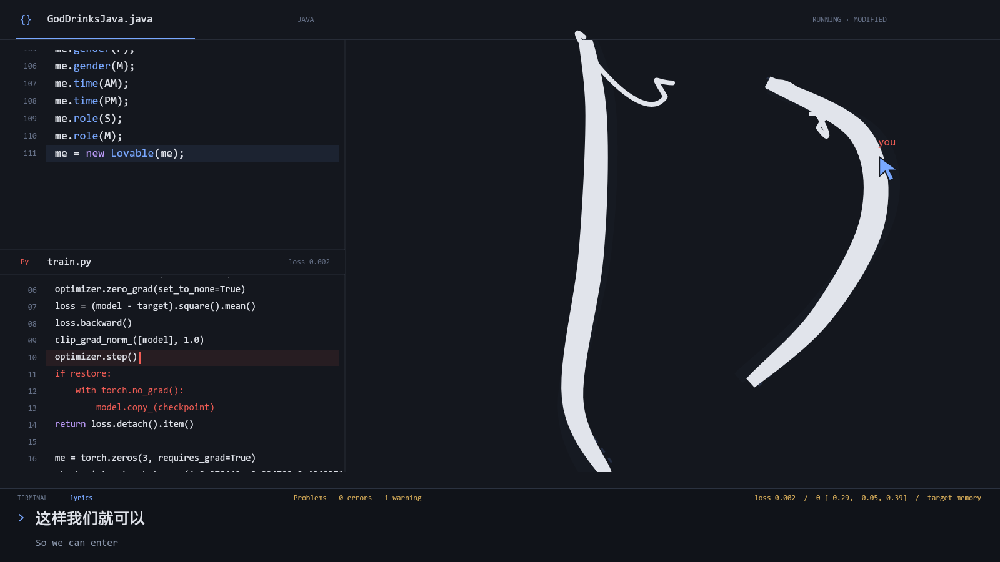

# world.execute(me);

一部以 Mili《world.execute(me);》为基础的网页图形演出。创作者用 Java 搭建世界，角色在 Python 中调整自己，从主动配合、暗中改写，到发现光标背后的人并试图挽留。代码、图形与报错共同参与表演。

**Music & lyrics by Mili · AI-assisted fan animation · Unofficial**



## 本地观看

需要 Node.js 22 或更新版本。

```sh
npm ci
npm start
```

打开 <http://127.0.0.1:4173/>，点击「选择音频」，选择自己的原版录音，再点击播放。支持浏览器能解码的 MP3、M4A、FLAC、WAV 等格式。

**仓库不包含歌曲音频或带音乐的成片。** 选择的文件只通过浏览器的本地对象 URL 播放，不上传到服务器、不持久保存；刷新后需要重新选择。

时间轴按《Miracle Milk》原版录音制作，音乐长约 3 分 32 秒。播放器会拒绝时长相差超过 1 秒的文件；相同时长并不保证版本相同，请避免使用改编版或带额外片头的文件。音乐结束后，画面立即留白 3 秒。

播放、暂停、重播、进度拖动、中英字幕和全屏均可使用。互动段落中，角色会回应画面内的鼠标移动。空格切换播放，左右方向键跳转 5 秒，C 切换字幕，F 全屏。

## 表演方式

- Java 与 Python 始终同屏。Java 快速写入同一份文档，角色会改回创作者刚写下的约束，抢走输入点。
- 完整语句执行后改变图形；图形也会侵入源码、撕掉语句、吞噬诊断。EXECUTION 与独立歌词关键词共用节拍数据。
- 训练部分实际计算三个轮廓参数的 MSE、梯度裁剪和 SGD。loss 与参数更新改变轮廓，角色再修改训练目标。这是演出用的数值模型，并未下载或训练 LLM。
- META 段落由试探、跟随、挽留逐渐变成合拢身体阻止光标离开；失联后留下空握。真实鼠标只影响画面，不限制浏览器导航或退出。
- 最后一行由角色写下未闭合的 `world.execute(me`，没有执行结果。结尾保留未知。

## 开发与验证

```sh
npm test
npm run prepare:captions
npm run prepare:java
npm run stills
```

测试及 Java 生成额外需要 JDK 21，`java`、`javac` 放入 PATH，或设置 `JAVA_HOME`。测试和静帧生成不需要音频，也不需要 FFmpeg。依赖版本由 `package-lock.json` 锁定。

Java 源码可实际编译并输出 97 个事件，浏览器重放已生成的事件，不在网页中运行 JVM。Python 窗口使用 PyTorch 风格语法；实际数值更新在 JavaScript 中运行，无需安装 Python 或 PyTorch。

`npm test` 覆盖编译与事件一致性、同一行改写、训练反馈、图形接触、逐拍字幕、META 输入、本地音频选择、更换与错误恢复，以及结尾留白。

## 本地导出视频

观看网页不需要以下步骤。若要导出带音乐的 MP4，另安装 FFmpeg / FFprobe，并在 `references/` 中放入一份自己的原版 FLAC：

```sh
npm run prepare:media
npm run render
```

生成 `exports/graphic-film.mp4`，并写入本地网页目录。输出为 1600×900、30fps、H.264/AAC，总长约 214.91 秒。浏览器与视频使用相同的绘图函数，视频使用预编排的光标轨迹。导出文件与音频均被 Git 忽略。

`npm run stills` 输出代表帧与整曲联系表到 `exports/`。Windows 使用 Consolas、Arial 与 Microsoft YaHei；其他系统使用本机可用字体，中文需安装相应字体，排版可能略有差异。

## 目录

| 路径 | 内容 |
| --- | --- |
| `dist/study/graphic/` | 当前网页与绘图源码；`dist` 在本项目中是静态源码目录 |
| `dist/study/graphic/full/` | 时间轴、Java 事件、训练、META、报错、字幕与播放器 |
| `dist/media/cues.mjs`、`cues.json` | 随仓库保留的字幕及节拍数据，不包含音频 |
| `dist/film/timeline.mjs` | LRC 解析与统一 0.5 秒延时 |
| `java/graphic/goddrinksjava/` | 可编译的 Java 源码 |
| `references/translations/` | 用户提供的中英文本、断句与时间参考 |
| `scripts/`、`tests/` | 本地服务、生成与导出脚本、自动检查 |
| `docs/current-design.md` | 当前美术、情绪与实现约定 |

## 署名与参考

歌曲与歌词为 **Mili《world.execute(me);》**。本项目为非官方、AI 辅助制作的同人动画，与 Mili 或 JetBrains 无隶属关系。

Java 叙事致敬 [Mili 官方 MV](https://www.youtube.com/watch?v=ESx_hy1n7HA)，编辑器结构参考 IntelliJ IDEA。这里的 Java 为本项目编写，并非官方源码复刻。中文及断句遵循用户提供的参考，详见 [字幕说明](references/translations/README.md) 与 [素材来源](references/material-sources.md)。

音乐相关使用请查阅 [Mili 官方说明](https://projectmili.com/copyright-guidelines)。仓库不提供歌曲下载，也不授予第三方音乐、歌词或字体的使用许可。
